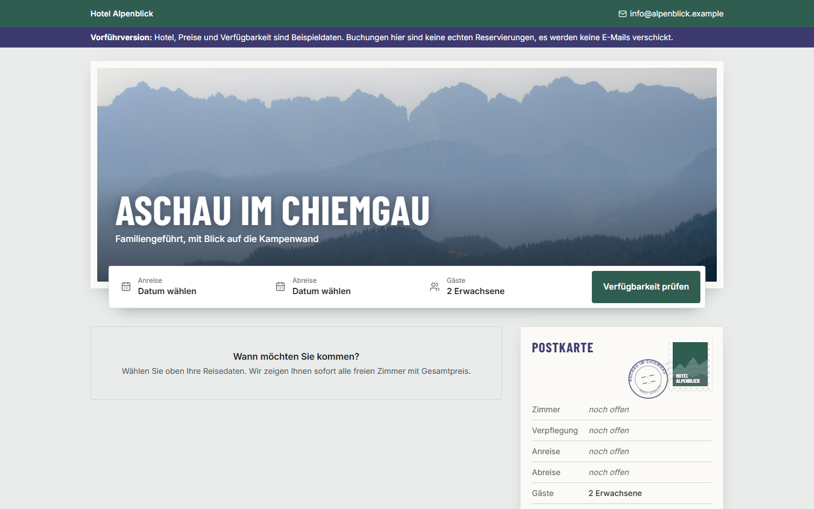
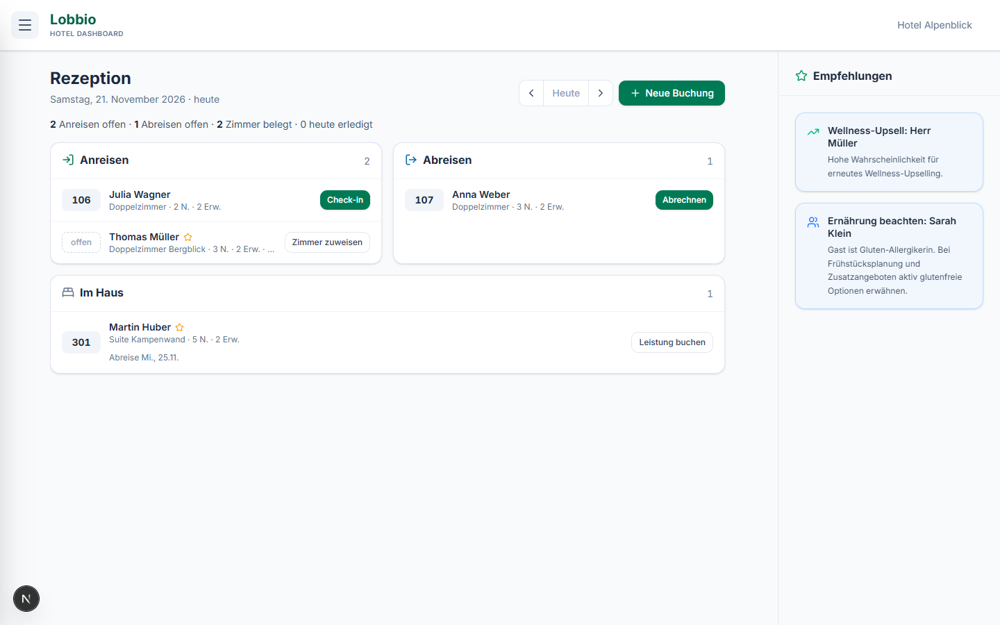
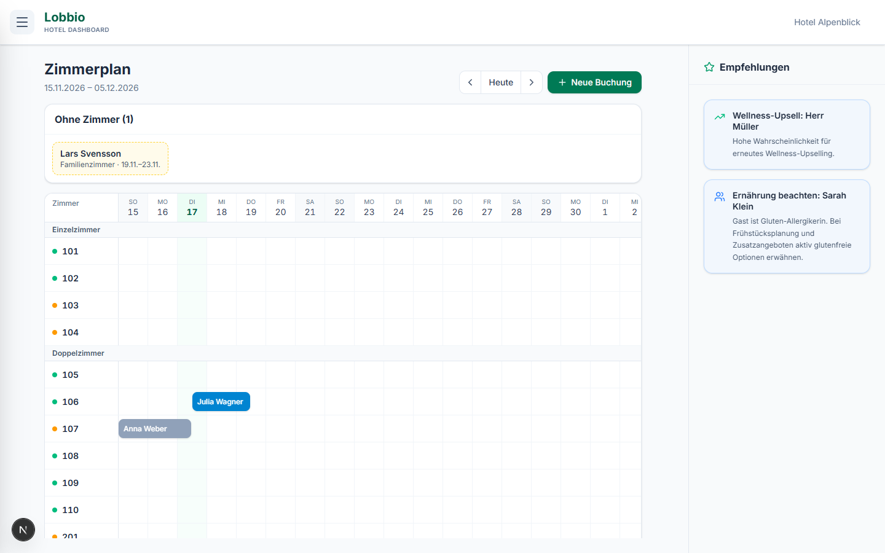

<div align="center">

# Lobbio

**Gästekommunikation, Hotelbetrieb und Direktbuchung in einer Software – gebaut für familiengeführte Hotels.**

Next.js 16 · TypeScript · Supabase · Tailwind CSS v4 · Claude API

</div>

---

Lobbio richtet sich an kleine und mittlere Hotels und Pensionen im deutschsprachigen Raum (10–40 Zimmer), die ohne eigene IT auskommen müssen. Die Software verbindet drei Bausteine, die auf denselben Daten arbeiten:

| Baustein | Für wen | Kernnutzen |
| --- | --- | --- |
| **KI-Dashboard** | Inhaber, Front Office | E-Mails, Bewertungen und Gästewissen an einem Ort; die KI schreibt Antwortentwürfe, der Mensch gibt frei |
| **PMS-Modul** (optional) | Rezeption, Housekeeping | Rezeption, Zimmerplan, Raten, Folio und Rechnung, Zimmerstatus |
| **Buchungsportal** | Gäste | Verbindliche Direktbuchung ohne Provision, im Erscheinungsbild des Hotels |

Weil alles in einer Datenbank liegt, kennt die KI beim Beantworten einer Anfrage die echte Verfügbarkeit, die Buchungen und die Gästehistorie.

<p align="center">
  
</p>

<p align="center">
  
  
</p>

<p align="center"><sub>Alle Namen und Daten in den Screenshots sind fiktive Beispieldaten.</sub></p>

## Funktionen

### Buchungsportal (`/buchen/<hotel>`)

- Eigenes Portal je Hotel mit Farben, Titelbild und Texten des Betriebs (White-Label)
- Live-Verfügbarkeit pro Zimmertyp auf Basis einzelner Nächte
- Raten (z. B. mit oder ohne Frühstück), Saisonpreise und Mindestaufenthalt
- Transparenter Endpreis mit Kurtaxe und getrennt ausgewiesener Mehrwertsteuer (7 % / 19 %)
- Verbindliche Buchung mit Buchungscode und Bestätigungs-E-Mail; Zahlung vor Ort
- Schutz vor Überbuchung: Buchungen laufen als atomare Datenbankfunktion mit Sperre je Hotel
- Für das Smartphone optimiert

### PMS-Modul

- **Rezeption:** Anreisen, Abreisen und Gäste im Haus; Check-in mit Zimmerzuweisung und digitalem Meldeschein, Check-out mit Rechnungsabschluss
- **Zimmerplan:** Belegungsraster Zimmer × Tage, Buchungen per Klick öffnen und bearbeiten
- **Raten & Zimmer:** Zimmertypen, Grundpreise, Raten und Saisons
- **Folio & Rechnung:** Gastkonto mit Übernachtungen, Extras, Kurtaxe und Zahlungen; Rechnung mit fortlaufender Nummer als Druck oder PDF
- **Housekeeping:** Zimmerstatus (schmutzig, sauber, geprüft, außer Betrieb), auch mobil
- Änderungen erscheinen per Realtime ohne Neuladen auf allen Geräten

### KI-Dashboard

- Gmail-Anbindung per OAuth: E-Mails werden abgeholt, eingeordnet und mit Antwortentwurf versehen
- Buchungsanfragen werden automatisch gegen die echte Verfügbarkeit geprüft
- Keine erfundenen Zusagen: Offene Punkte werden zu Aufgaben mit späterer Folge-E-Mail
- Bewertungsmanagement mit Stimmungsanalyse und Antwortvorschlägen
- Gästekartei, Buchungsübersicht, Wissensdatenbank des Hotels, Aufgaben und Auswertungen

### Rechtliche Anforderungen (Deutschland)

- Digitaler Meldeschein nach BMG §§ 29–30
- Kurtaxe bzw. Gästebeitrag je Gemeinde konfigurierbar, als nicht steuerbarer Posten ausgewiesen
- Rechnungen mit Pflichtangaben; abgerechnete Posten sind in der Datenbank gegen Änderung gesperrt

> Lobbio unterstützt bei diesen Pflichten, ersetzt aber keine steuerliche oder rechtliche Beratung.

## Technik

| Bereich | Umsetzung |
| --- | --- |
| Frontend | Next.js 16 (App Router, Turbopack), React 19, Tailwind CSS v4, shadcn/ui |
| Backend | Next.js Route Handlers, Vercel Cron |
| Datenbank | Supabase (PostgreSQL, Auth, Realtime) |
| Mandantentrennung | Row Level Security – jede Zeile gehört genau einem Hotel |
| KI | Claude API (Anthropic) |
| E-Mail | Gmail API über Google OAuth, Tokens verschlüsselt gespeichert |

```
app/
  buchen/[slug]/      Öffentliches Buchungsportal
  dashboard/          KI-Dashboard und PMS-Module (Rezeption, Zimmerplan, …)
  rechnung/[id]/      Druckbare Rechnung
  api/                Route Handler (Portal, PMS, Gmail-Sync, Bewertungen, Cron)
components/           UI-Komponenten (pms/, dashboard/, landing/)
lib/
  pms/                Preis-, Verfügbarkeits- und Steuerlogik (eine Quelle für Portal und PMS)
supabase/
  migrations/         Datenbankschema als Migrationen
  seed.sql            Beispieldaten für die lokale Entwicklung
  demo/               Demo-Hotel für Vorführungen und Anleitung zum Live-Update
docs/screenshots/     Bilder für diese README
```

Gestaltungsregeln und Produktgrundlagen stehen in [`DESIGN.md`](DESIGN.md) und [`PRODUCT.md`](PRODUCT.md).

## Lokale Entwicklung

### Voraussetzungen

- Node.js 20 oder neuer
- Docker (für die lokale Supabase-Instanz)
- Optional: Anthropic-API-Schlüssel und ein Google-OAuth-Client für KI und Gmail

### Einrichtung

```bash
# 1. Abhängigkeiten installieren
npm install

# 2. Lokale Datenbank starten – wendet alle Migrationen und seed.sql an
npx supabase start

# 3. Konfiguration anlegen und mit den Werten aus `npx supabase status` füllen
cp .env.example .env.local

# 4. Entwicklungsserver starten
npm run dev
```

Die App läuft danach unter <http://localhost:3000>, Supabase Studio unter <http://127.0.0.1:54323>.

Ein Login ist ein Benutzer in Supabase Auth; seine Benutzer-ID ist zugleich die `hotel_id`. Den Benutzer legst du in Supabase Studio unter *Authentication* an. Für ein vollständig befülltes Vorführ-Hotel siehe [`supabase/demo/`](supabase/demo/).

### Umgebungsvariablen

Alle Variablen sind in [`.env.example`](.env.example) beschrieben. Echte Werte gehören ausschließlich in `.env.local` (lokal) bzw. in die Umgebungsvariablen des Hostings – niemals ins Repository.

| Variable | Zweck |
| --- | --- |
| `NEXT_PUBLIC_SUPABASE_URL`, `NEXT_PUBLIC_SUPABASE_ANON_KEY` | Verbindung zu Supabase (öffentlich, durch RLS geschützt) |
| `SUPABASE_SERVICE_ROLE_KEY` | Serverseitiger Zugriff für Portal und Cron – nie im Browser |
| `ANTHROPIC_API_KEY` | KI-Antwortentwürfe und Bewertungsanalyse |
| `GOOGLE_CLIENT_ID`, `GOOGLE_CLIENT_SECRET` | Gmail-Anbindung |
| `NEXTAUTH_URL`, `NEXTAUTH_SECRET` | OAuth-Sitzungen |
| `ENCRYPTION_KEY` | Verschlüsselung gespeicherter OAuth-Tokens (32 Zeichen) |
| `CRON_SECRET` | Absicherung des E-Mail-Sync-Endpunkts |

### Befehle

| Befehl | Wirkung |
| --- | --- |
| `npm run dev` | Entwicklungsserver |
| `npm run build` | Produktions-Build |
| `npm run start` | Produktions-Build starten |
| `npm run lint` | ESLint |

## Deployment

1. **Erst die Datenbank, dann der Code:** Neue Migrationen mit `npx supabase db push` einspielen (Details in [`supabase/demo/LIVE-UPDATE.md`](supabase/demo/LIVE-UPDATE.md)).
2. Auf Vercel deployen und die Umgebungsvariablen aus `.env.example` im Projekt hinterlegen.
3. Der Cron-Job in [`vercel.json`](vercel.json) synchronisiert die Postfächer alle 10 Minuten.

## Sicherheit

- Der Service-Role-Schlüssel wird nur serverseitig verwendet; das Portal gibt ausschließlich freigegebene Hoteldaten und keine Gästedaten heraus.
- Alle Tabellen sind per Row Level Security auf das eigene Hotel beschränkt.
- OAuth-Tokens werden verschlüsselt (AES) in der Datenbank abgelegt.
- Sicherheitslücken bitte nicht öffentlich als Issue melden, sondern direkt an die Projektverantwortlichen.

## Projektstand

Lobbio ist ein funktionsfähiger Prototyp. Geplant bzw. offen:

- Online-Zahlung (Stripe)
- Anbindung echter Google-Bewertungen über die Google Business Profile API (derzeit Testdaten)
- Channel-Manager / OTA-Anbindung
- Englischsprachiges Buchungsportal

## Bildnachweise

Die Fotos des Demo-Hotels stammen von [Unsplash](https://unsplash.com/license) und sind dort frei nutzbar; die einzelnen Nachweise stehen in [`DESIGN.md`](DESIGN.md#bildnachweise-demo-betrieb).

## Lizenz

Alle Rechte vorbehalten. Der Quellcode ist zur Ansicht veröffentlicht; eine Nutzung, Veränderung oder Weitergabe bedarf der Zustimmung des Autors.
